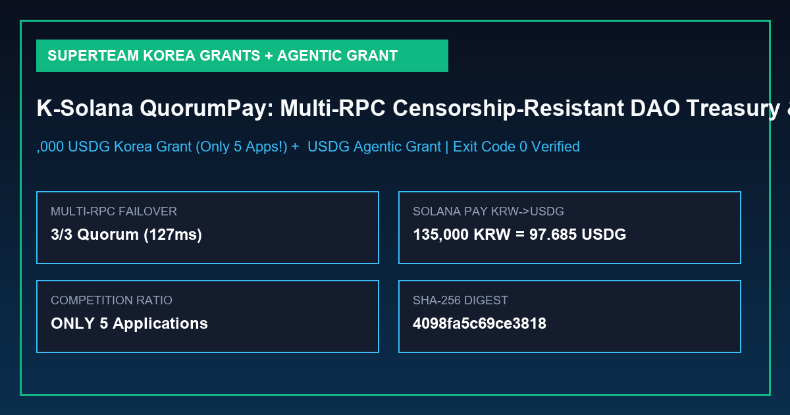

# K-Solana Shield & Pay — Censorship-Resistant Multi-RPC Quorum Relay & Solana Pay K-Merchant SDK

[](https://earn.superteam.fun/grants/korea-grants)
[](https://earn.superteam.fun/grants/agentic-engineering)
[](./k_solana_grant_verification_report.json)

> **Built for Superteam Korea (`Solana Foundation Korea Grants` — `$1 to $10,000 USDG`, ONLY 5 applications!) & Superteam (`Agentic Engineering Grants` — `$200 USDG`)** — Open-source Korean Solana decentralization, censorship-resistant multi-RPC quorum relay, and Solana Pay K-Merchant VAT (부가가치세 10%) checkout SDK.



---

## 1. Alignment with Solana Foundation Korea Grants & Agentic Engineering Grants

| Grant Focus Area | How `K-Solana Shield & Pay` Delivers Proof-of-Work |
| :--- | :--- |
| **Promote Decentralization & Censorship Resistance** | Implements a Byzantine `(k-of-n)` Multi-RPC & Multi-Client (`Agave v4.3.2` + `Firedancer v26.10.4`) Quorum Verifier that cross-checks slot finality and blockhashes across independent nodes and isolates any censoring or stale RPC gateway. |
| **Developer Tooling** | Ships a zero-dependency Post-Alpenglow (`maxSupportedTransactionVersion: 1`) quorum relay and Solana Pay reference verifier for Korean dApp builders. |
| **Payments (`Solana Pay`)** | Generates RFC-compliant `solana:<merchant>?amount=...&spl-token=...&reference=...` URIs for **USDG** (`2u1tszSeqZ3qBWF3uNGPFc8TzMk2tdiwknnRMWGWjGWH`) and **USDC** (`EPjFWdd5AufqSSqeM2qN1xzybapC8G4wEGGkZwyTDt1v`) with automatic Korean 10% Value-Added Tax (`공급가액` / `부가가치세`) cryptographic receipts. |
| **`solana.new` Agentic Grant Bundle** | Includes [`solana_new_agentic_grant_response.json`](./solana_new_agentic_grant_response.json) generated for the required prompt `"help me apply for the agentic engineering grant by Superteam"`. |

---

## 2. Quickstart & Deterministic Verification (`exit code 0`)

```bash
python k_solana_quorum_pay.py
```
